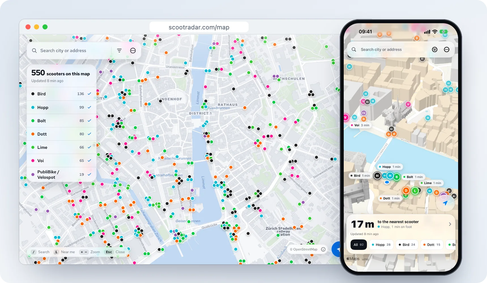
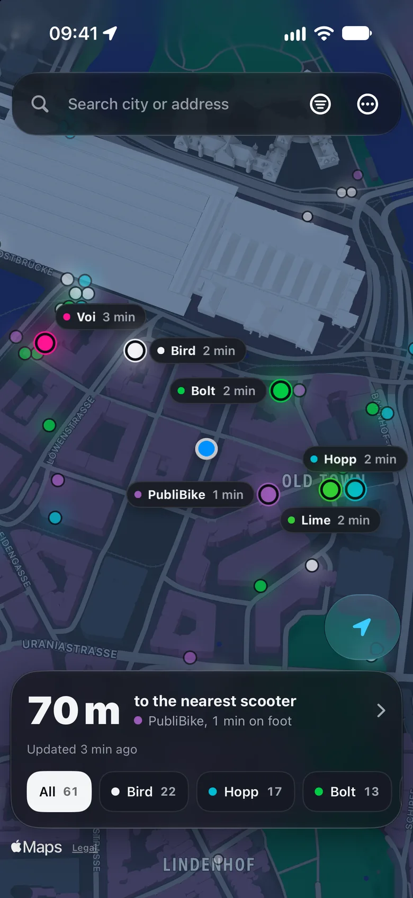
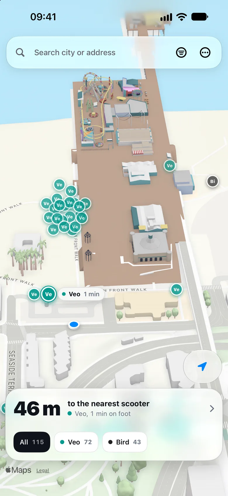
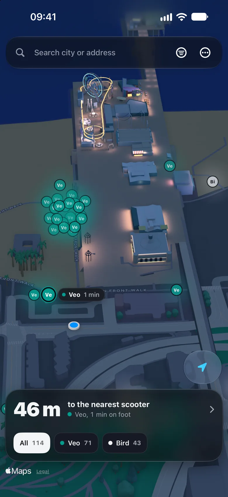

<p align="center">
  
</p>

<h1 align="center">ScootRadar</h1>

<p align="center">
  Every shared e-scooter around you, on one map.<br>
  Lime, Bolt, Bird, Voi, Dott, Hopp and 17 more: 23 providers in over 530 cities in 28 countries.
</p>

<p align="center">
  <a href="https://github.com/plhery/ScootRadar/actions/workflows/ci.yml"></a>
  <a href="LICENSE"></a>
</p>

<p align="center">
  <a href="https://scootradar.com/map"><strong>Open the map</strong></a>
  &nbsp;&nbsp;
  <a href="https://scootradar.com">scootradar.com</a>
</p>

<p align="center">
  <picture>
    <source media="(prefers-color-scheme: dark)" srcset="docs/readme/hero-dark.webp">
    
  </picture>
</p>

Every scooter company has its own app, and each app shows only its own fleet.
By Zürich main station, seven companies can have a scooter within two
minutes' walk away, and finding the nearest one means opening seven apps.
ScootRadar reads the feeds the operators publish and puts every scooter on one
map, so the nearest one is simply the nearest one.

It's free, with no account and no ads. Use it in the browser, install it as a
web app, or get the iPhone app on the
[App Store](https://apps.apple.com/app/id6823614854).

## What it tells you

- **Which scooter is closest?** Tap *Near me*, or search a city, a street or
  an address, in the country's own script too. Every provider's scooters are
  on the map, with the walking time to each.
- **Will it get me there?** A scooter shows its battery and range when its
  provider publishes them. Set a minimum and the flat ones disappear.
- **What will the ride cost?** An estimate from the provider's published rates,
  for a ride of 5 to 30 minutes, before you walk over.
- **Where can I leave it?** At street zoom, the operators' parking bays show as
  **P** markers, with the rules each operator publishes, and closed bays are
  left out. Settings can also show the ride and parking zones. Coverage
  depends on each operator's feed, so check its app before ending a ride.
- **Then what?** One tap opens the provider's own app, where you unlock and pay
  as usual. Opening it doesn't reserve the scooter.
- **What if something's off?** The map says so in plain words: a provider that
  isn't sharing data, positions that are out of date, a town whose scooters are
  away for the winter, or an area with no data and the closest cities that have
  it.

It speaks English, German, French, Italian, Dutch, Norwegian, Portuguese,
Spanish and Icelandic. It follows your device's light or dark appearance, or
keeps the one you pick. On a desktop, the providers form a legend, a scooter's
card opens beside its marker, and `/`, `L`, `+`, `−` and `Esc` work from the
keyboard.

<p align="center">
  
  &nbsp;
  
  &nbsp;
  
</p>

## Where the scooters come from

Switzerland's scooters come from its national open-data platform, the
[Open data platform mobility Switzerland](https://data.opentransportdata.swiss/en/dataset/sharedmobility).
The other countries' come from the feeds their operators and national platforms
publish. [DATA_SOURCES.md](DATA_SOURCES.md) lists each country's feeds and links
its audit, and [Coverage gaps](docs/coverage-gaps.md) lists what isn't covered
yet, and why.

Address search comes from Geoapify (OpenStreetMap and other open data), with
komoot's Photon standing in, and the web map is drawn from OpenFreeMap tiles of
OpenStreetMap data. The app keeps no account and no location history; see
[Privacy](PRIVACY.md).

## Run it locally

You need Node.js 26+ and npm.

```bash
git clone https://github.com/plhery/ScootRadar.git
cd ScootRadar
npm ci
npm run dev
```

Open [localhost:3000](http://localhost:3000). That's all: there are no
environment variables, API keys, databases or accounts to set up.

[CONTRIBUTING.md](CONTRIBUTING.md) lists the checks to run before a pull
request, and [Adding a country](docs/adding-a-country.md) walks through a new
country's feeds.

## iPhone app

The app is on the [App Store](https://apps.apple.com/app/id6823614854), for
iOS 26 or newer. To build it yourself, open `ios/ScootRadar.xcodeproj` in Xcode
26+, choose a development team, and run the `ScootRadar` scheme.
[ios/README.md](ios/README.md) has the details.

## Host your own

The included configuration targets Cloudflare Workers through OpenNext. Give
your fork a Worker name and hostname in `wrangler.jsonc`. Deploy the persistent
cache with `server/Dockerfile` and a `/data` volume, and set
`SCOOTER_SNAPSHOT_API_URL` to that origin. Configure the same
`SCOOTER_SNAPSHOT_API_TOKEN` secret on the cache and the Worker (see the first
rollout's order in [DEPLOY.md](DEPLOY.md)). Then:

```bash
npx wrangler login
npm run deploy
```

[DEPLOY.md](DEPLOY.md) covers rate limits, previews, production checks and
rollbacks. CI's Deploy job tells IndexNow about new pages of scootradar.com with
ScootRadar's key (`scripts/indexnow.mjs`): give your fork a key and address of
its own, or remove those steps.

## More

- [Data sources and attribution](DATA_SOURCES.md)
- [Privacy](PRIVACY.md)
- [Web and iOS analytics](docs/analytics.md)
- [Contributing](CONTRIBUTING.md)
- [Security](SECURITY.md)

ScootRadar is open source under the [MIT License](LICENSE). Come build with us.
