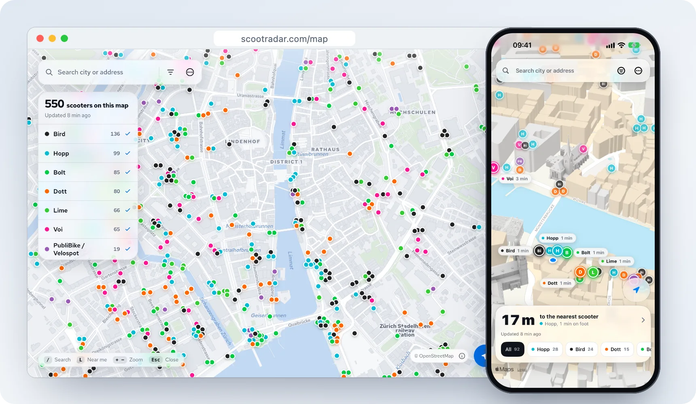
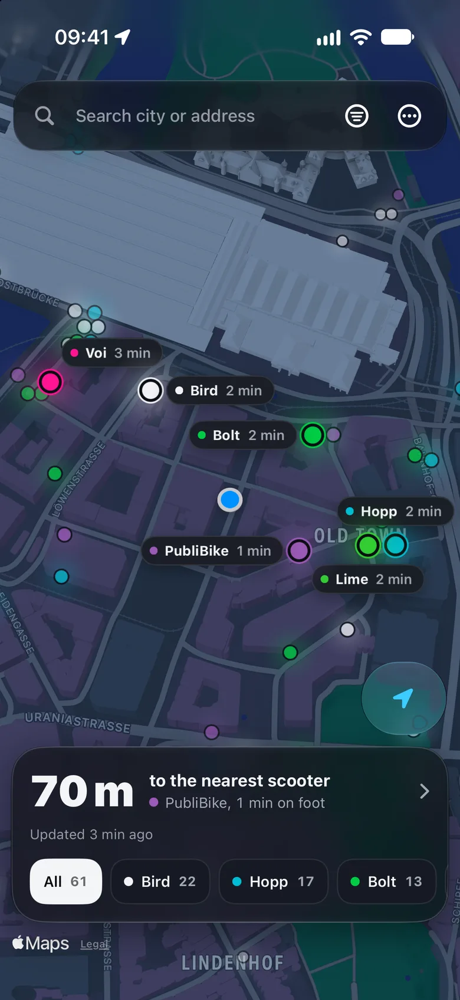
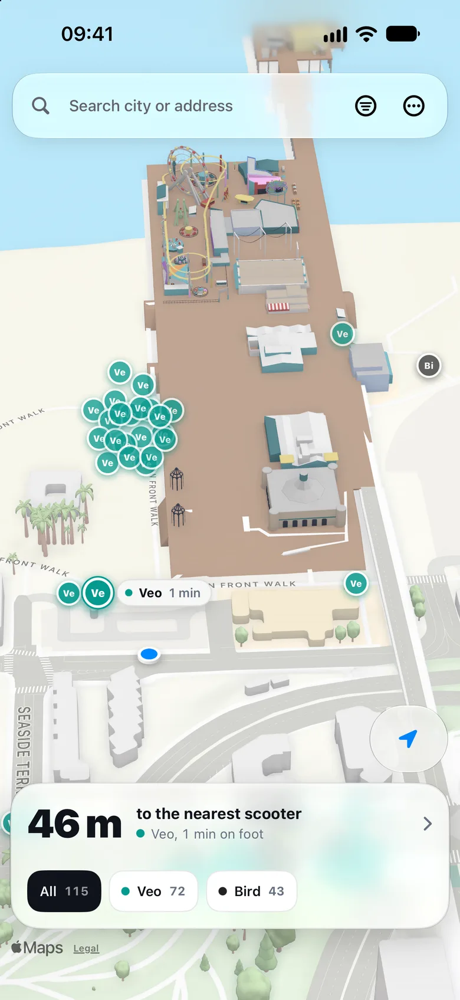
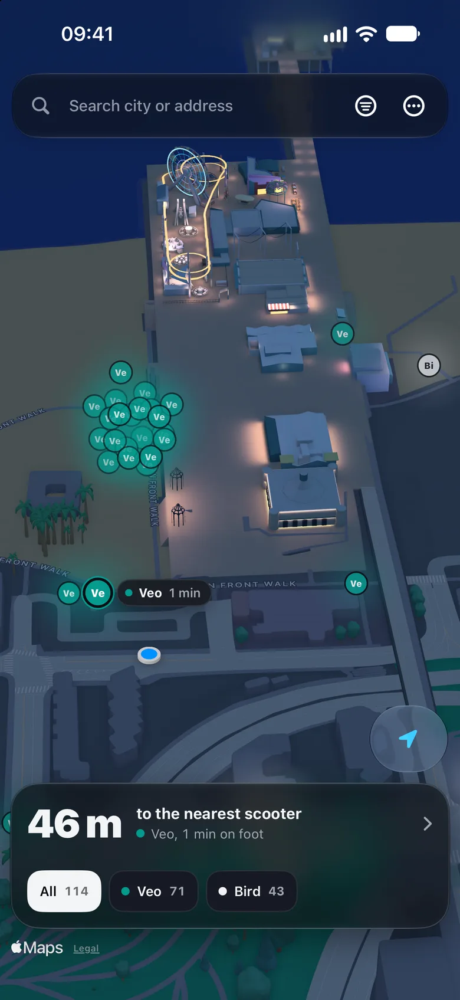

<p align="center">
  
</p>

<h1 align="center">ScootRadar</h1>

<p align="center">
  Every shared e-scooter around you, on one map.<br>
  Lime, Bolt, Bird, Voi, Dott, Hopp and 33 more: 39 providers in over 1,000 cities in 59 countries.
</p>

<p align="center">
  <a href="https://github.com/plhery/ScootRadar/actions/workflows/ci.yml"></a>
  <a href="LICENSE"></a>
</p>

<p align="center">
  <a href="https://scootradar.com/map"><strong>Open the map</strong></a>
  &nbsp;&nbsp;
  <a href="https://scootradar.com">scootradar.com</a>
</p>

<p align="center">
  <picture>
    <source media="(prefers-color-scheme: dark)" srcset="docs/readme/hero-dark.webp">
    
  </picture>
</p>

Every scooter company has its own app, and each app shows only its own fleet.
By Zürich main station, seven companies can have a scooter within two
minutes' walk away, and finding the nearest one means opening seven apps.
ScootRadar reads the feeds the operators publish and puts every scooter on one
map, so the nearest one is simply the nearest one.

It's free, with no account and no ads. Use it in the browser, install it as a
web app, or get the app: on the [App Store](https://apps.apple.com/app/id6823614854)
for the iPhone, and on Google Play for Android, where it is in a
[test you can join](#android-app) before its release.

## What it tells you

- **Which scooter is closest?** Tap *Near me*, or search a city, a street or
  an address, in the country's own script too. Every provider's scooters are
  on the map, with the walking time to each.
- **Will it get me there?** A scooter shows its battery and range when its
  provider publishes them. Set a minimum range, in kilometres or miles, and
  the scooters that may not get that far disappear. A scooter that gives only
  its battery is judged by how far a full battery of its provider's goes at
  the least (`data/battery-full-ranges.json`), and the filters say what
  battery that asks of each app's in view: "at least 9% (Voi), 21% (Bolt) and
  53% (Lime)" for 6 km.
- **What will the ride cost?** An estimate from the provider's published rates,
  for a ride of 5 to 30 minutes, before you walk over.
- **Where can I leave it?** At street zoom, the operators' parking bays show as
  **P** markers, with the rules each operator publishes, and closed bays are
  left out. Zoomed in, the map also draws the ride and parking zones, with a
  legend: those the operators publish, which Settings can turn off, and those
  a city sets. Coverage depends on each operator's feed, so check its app
  before ending a ride.
- **Then what?** One tap opens the provider's own app, where you unlock and pay
  as usual. Opening it doesn't reserve the scooter.
- **What if something's off?** The map says so in plain words: a provider that
  isn't sharing data, positions that are out of date, a town whose scooters are
  away for the winter, or an area with no data and the closest cities that have
  it.

It speaks English, German, French, Italian, Dutch, Norwegian, Portuguese,
Spanish and Icelandic. It follows your device's light or dark appearance, or
keeps the one you pick. On a desktop, the providers form a legend, a scooter's
card opens beside its marker, and `/`, `L`, `+`, `−` and `Esc` work from the
keyboard.

<p align="center">
  
  &nbsp;
  
  &nbsp;
  
</p>

## Where the scooters come from

Switzerland's scooters come from its national open-data platform, the
[Open data platform mobility Switzerland](https://data.opentransportdata.swiss/en/dataset/sharedmobility).
The other countries' come from the feeds their operators and national platforms
publish. [DATA_SOURCES.md](DATA_SOURCES.md) lists each country's feeds and links
its audit, and [Coverage gaps](docs/coverage-gaps.md) lists what isn't covered
yet, and why.

Address search comes from Geoapify (OpenStreetMap and other open data), with
komoot's Photon standing in, and the web map is drawn from OpenFreeMap tiles of
OpenStreetMap data. The app keeps no account and no location history; see
[Privacy](PRIVACY.md).

## Run it locally

You need Node.js 26+ and npm.

```bash
git clone https://github.com/plhery/ScootRadar.git
cd ScootRadar
npm ci
npm run dev
```

Open [localhost:3000](http://localhost:3000). That's all: there are no
environment variables, API keys, databases or accounts to set up. It runs as
scootradar.com, from the settings in `wrangler.jsonc`; to run a copy of your
own, see [Run your own](#run-your-own).

[CONTRIBUTING.md](CONTRIBUTING.md) lists the checks to run before a pull
request, and [Adding a country](docs/adding-a-country.md) walks through a new
country's feeds.

## iPhone app

The app is on the [App Store](https://apps.apple.com/app/id6823614854), for
iOS 26 or newer. To build it yourself, open `ios/ScootRadar.xcodeproj` in Xcode
26+, choose a development team, and run the `ScootRadar` scheme.
[ios/README.md](ios/README.md) has the details.

## Android app

The app is in a closed test on Google Play before its release, for Android 12
or newer. Anyone can join it, in about a minute, with one Google account:

1. Join the [ScootRadar Android testers](https://groups.google.com/g/scootradar-android-testers)
   group.
2. Open [the test's page on Google Play](https://play.google.com/apps/testing/com.plhery.scootradar)
   and tap **Become a tester**.
3. [Install the app from Google Play](https://play.google.com/store/apps/details?id=com.plhery.scootradar),
   and keep it for two weeks: Google Play opens it to everyone once 12 testers
   have stayed in the test for 14 days.

You can leave the test at any time, on the same page of Google Play. The site
offers the same steps under its *Android app* button.

The same beta, built without Google's libraries and signed with ScootRadar's own key, is in [ScootRadar's F-Droid repository](https://raw.githubusercontent.com/plhery/ScootRadar/fdroid/repo?fingerprint=682DDF19FD7F9CD56882825B4ABCE3254ED5B528C6D1D95E06D54791B4F8CCA0)
and on [GitHub Releases](https://github.com/plhery/ScootRadar/releases).
To add the repository, open the F-Droid app, go to Settings → Repositories → +,
and paste the whole address, `?fingerprint=…` included:

```
https://raw.githubusercontent.com/plhery/ScootRadar/fdroid/repo?fingerprint=682DDF19FD7F9CD56882825B4ABCE3254ED5B528C6D1D95E06D54791B4F8CCA0
```

Opened in a browser, the address shows a 404 page; that's expected.

To build it yourself, run `npm ci` at the top of the repository first (the
build writes the app's API models and provider catalog with the site's
scripts), then open `android/` in Android Studio and run the `app`
configuration, or connect a phone and run `./gradlew :app:installPlayDebug` in
`android/` with JDK 21.
The `fdroid` flavor (`:app:assembleFdroidRelease`) is the build for F-Droid's
catalog, without Google Play's card to rate the app.

Once a release reaches Google Play's closed test, the same commit's `fdroid`
build, signed with the upload key, goes to the F-Droid repository and GitHub
Releases. Play's own copies don't: Play protects the copies it signs, and they
refuse to open on a phone without the Play Store.

```sh
./gradlew :app:assembleFdroidRelease -Pscootradar.uploadKey=<path>   # in android/
SCOOTRADAR_FDROID_DIR=<path> android/scripts/publish-fdroid.sh android/app/build/outputs/apk/fdroid/release/app-fdroid-release.apk <commit> [notes.md]
```

The script refuses an APK that the upload key alone did not sign, or that
carries Google's libraries, and a commit that isn't on GitHub's `main`. Before
anything is pushed, it refuses a version code older than the repository's, or
one the repository lists already with another APK: a version code goes out with
one APK, which a run after a failure may publish again
(`android/scripts/check-fdroid-version.test.sh`). One run at a time holds the
repository's folder; a run killed with `-9` leaves its lock, and the next run
says so and how to remove it. It tags
that commit `android-<versionName>-<versionCode>`, signs the repository's index
with the repository's key, which stays outside the repository in
`SCOOTRADAR_FDROID_DIR` with fdroid's `config.yml`, puts the repository alone
on the `fdroid` branch, which raw.githubusercontent.com serves, and attaches
the APK to a pre-release on the tag. Run again after a failure, it finishes the
release: a draft left by a run cut off is published, with the APK uploaded again
if it isn't there whole, and a release holding another APK of that name stops it
(`android/scripts/publish-github-release.test.sh` runs that step on a fake `gh`). Copies
from Google Play, and the ones the repository and GitHub had before 18 November
2026, are signed by Google Play, so they have to be uninstalled before this one
goes on; the release notes and the repository's entry say so. The app's entry in the
repository, with the anti-features F-Droid shows, is
[`android/fdroid/com.plhery.scootradar.yml`](android/fdroid/com.plhery.scootradar.yml).

## Run your own

Anyone can run the code under a name of their own. Without settings it is a
neutral "Scooter map": no guides, no apps, no analytics, nothing of
ScootRadar's own, which the code's license doesn't cover
([Name, logo and guides](#name-logo-and-guides)). The license asks a copy to
keep the credit "Based on ScootRadar by Paul-Louis Hery", with its link, and,
if you change the code, to offer your version's source to the people who use
it: point `SOURCE_URL` at your fork ([License](#license)).

### What you need

- Node.js 26+ and npm.
- To put it on the web, a Cloudflare account: the site runs on Cloudflare
  Workers through OpenNext.
- Optionally, a server with Docker for the scooter cache (below).

No database and no API key: the feeds the map reads are public.

### Settings

The settings are the `vars` of `wrangler.jsonc`. The build reads them
(`next.config.ts`) and writes them into the pages, and the Worker is given them
when it runs, so both always say the same; `npm run dev`, the tests and the
scripts read the same file. The repository's are scootradar.com's: replace
them, or delete a line to take its default. A value the code can't use, such as
an address that isn't one or a switch that isn't `on` or `off`, stops the build.
[`src/lib/siteSettings.ts`](src/lib/siteSettings.ts) says what each does.

| Setting | Default | What it does |
| --- | --- | --- |
| `SITE_URL` | `http://localhost:3000` | The origin the site is served from: its links, canonical addresses, sitemap and share images, and the address it gives the feeds. |
| `SITE_NAME` | `Scooter map` | What the site calls itself in its text and titles, and in its user agent, `scooter-map/2.0 (your.host)`. |
| `SITE_GUIDES` | `off` | `on` publishes the guides in `src/guides`, which are ScootRadar's. Off, their pages answer 404, and they leave the sitemap, the hreflang links and the site's links. |
| `SITE_MAKER` | `off` | `on` ends each page with the line on who makes ScootRadar. |
| `CONTACT_EMAIL` | none | The address the privacy notice and the accessibility page give, and the contact sent to the feeds that ask for one. Without it, neither page gives one. |
| `SOURCE_URL` | this repository | The source code the site links to: point it at your fork. |
| `ANALYTICS_URL`, `ANALYTICS_WEBSITE_ID` | none | An Umami server's `…/api/send` and the site's ID there. Without both, nothing is counted. |
| `TURNSTILE_SITE_KEY` | none | A Cloudflare Turnstile site key. With the Worker secrets `TURNSTILE_SECRET_KEY` and `MAP_PASS_SECRET`, the map proves it is a browser before it gets scooters ([DEPLOY.md](DEPLOY.md), "Map passes"). |
| `APP_STORE_ID`, `APP_STORE_PROVIDER_TOKEN` | none | An iPhone app's Apple ID, and the provider token of its campaign links. Without an ID, the site shows no iPhone app. |
| `ANDROID_APP_ID`, `PLAY_TEST_GROUP` | none | An Android app's ID on Google Play and the Google Group of its closed test. Without both, the site invites no one to a test. |

Two other vars name services: `SCOOTER_SNAPSHOT_API_URL`, the scooter cache
(below), and `WALK_ROUTE_API_URL`, the Valhalla server that routes walks.

### Data sources

- **Scooters:** the public feeds in [DATA_SOURCES.md](DATA_SOURCES.md), read
  without keys. The map's credits name each source under its terms: keep them.
  A few providers need credentials or an app's session, which only the cache
  holds ([`.env.example`](.env.example)); without them, those providers are
  left out. The feeds see your `SITE_NAME` and `SITE_URL` in the user agent,
  and sharedmobility.ch your `CONTACT_EMAIL`.
- **Address search:** komoot's public Photon, or Geoapify with the Worker secret
  `GEOAPIFY_API_KEY` ([DEPLOY.md](DEPLOY.md)).
- **Walking routes:** `WALK_ROUTE_API_URL`, FOSSGIS's public Valhalla in the
  repository's file. Its terms allow one request a second and no heavy use: a
  busy site runs its own.
- **Map tiles:** OpenFreeMap, which needs no key.

### First run

```bash
git clone https://github.com/plhery/ScootRadar.git my-scooter-map
cd my-scooter-map
npm ci
```

Then, in `wrangler.jsonc`:

1. give the Worker a `name` of its own, and `routes` on your own domain, or
   delete `routes` to serve it at its `workers.dev` address;
2. replace the `vars`, at least `SITE_URL` and `SITE_NAME`, and delete
   `SCOOTER_SNAPSHOT_API_URL` unless you run the cache;
3. create the KV namespace for maintenance notices,
   `npx wrangler kv namespace create MAINTENANCE`, and put its ID in
   `kv_namespaces`.

```bash
npm run dev        # http://localhost:3000
npm run preview    # the production build on Cloudflare's runtime
npx wrangler login
npm run deploy
```

Without the cache, the map's requests collect the feeds of the place it shows,
which can take a few seconds.
[DEPLOY.md](DEPLOY.md) covers rate limits, previews, production checks and
rollbacks.

### Off unless you turn it on

- the guides, the maker line, the apps, the analytics and the map passes (the
  settings above);
- browser error reports to Sentry (`SENTRY_BROWSER_DSN` in
  `src/lib/errorReportsConfig.ts`);
- the scooter cache, and Geoapify;
- CI's Deploy job, which runs only in `plhery/ScootRadar`: a fork's CI runs the
  checks and deploys nothing. Workers Builds or `npm run deploy` deploys it.

### What a copy replaces

- the name, the logo, the icons, `public/manifest.json` and the pictures
  (`public/share/`, which `npm run generate:share-images` draws again with your
  `SITE_NAME`, `public/landing/` and `docs/readme/`);
- `public/.well-known/`, which ties ScootRadar's apps to its domain, and
  `public/f165a5c7a3d4199af0d0bc0b01c6e4e7.txt`, ScootRadar's IndexNow key
  (`scripts/indexnow.mjs`): delete them, or use your own;
- `src/guides/`: leave `SITE_GUIDES` off, or write guides of your own;
- the privacy notice and the accessibility statement
  (`src/app/(map)/privacy/` and `src/app/(map)/accessibility/`), which describe
  ScootRadar's site, apps and services: yours say what your copy does;
- `ios/`, `android/`, `fastlane/` and `docs/app-store/`: ScootRadar's apps and
  their store listings, to delete, or to rename throughout;
- the old addresses in `src/lib/legacyHost.ts`, which do nothing on another
  domain.

### The scooter cache

Optional. Without it the Worker collects the feeds itself for each region it is
asked about. With it, a server collects them all the time and the Worker asks
it: deploy `server/Dockerfile` with a `/data` volume, set
`SCOOTER_SNAPSHOT_API_URL` to its origin, and give the cache and the Worker the
same `SCOOTER_SNAPSHOT_API_TOKEN` secret (the first rollout's order is in
[DEPLOY.md](DEPLOY.md)). The cache doesn't read `wrangler.jsonc`: give it your
`SITE_NAME`, `SITE_URL` and `CONTACT_EMAIL` in its environment, or it names
itself `scooter-map/2.0 (localhost:3000)` to the feeds.

## License

The code is under the [GNU Affero General Public License, version 3
only](LICENSE), with one additional term under its section 7(b)
([NOTICE](NOTICE)): copies and modified versions keep the credit "Based on
ScootRadar by Paul-Louis Hery", with a link to
<https://github.com/plhery/ScootRadar>, among the legal notices they show, such
as the website's footer or an app's About screen. Once, where a user can find
it, is enough.

## Name, logo and guides

The code's license doesn't cover the name "ScootRadar", its logo, its store
assets or the texts of its guides:
[TRADEMARKS.md](TRADEMARKS.md) says what that covers. A copy may not publish
them or use the name, and a fork renames itself.

## More

- [Data sources and attribution](DATA_SOURCES.md)
- [Privacy](PRIVACY.md)
- [Web, iOS and Android analytics](docs/analytics.md)
- [Contributing](CONTRIBUTING.md)
- [Name, logo and guides](TRADEMARKS.md)
- [Security](SECURITY.md)

ScootRadar's code is open source under the [GNU AGPL-3.0](LICENSE), with an
attribution term ([NOTICE](NOTICE)); its name, logo, store assets and guides are
not ([TRADEMARKS.md](TRADEMARKS.md)). Come build with us.
