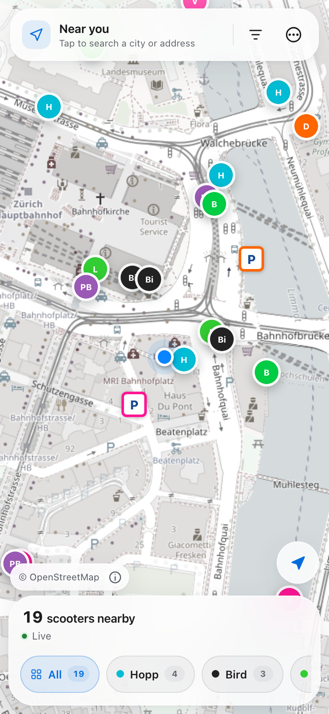

<p align="center">
  
</p>

<h1 align="center">ScootRadar</h1>

<p align="center">
  A friendly map for finding shared e-scooters in Switzerland and cities across Europe.
</p>

<p align="center">
  <a href="https://github.com/plhery/ScootRadar/actions/workflows/ci.yml"></a>
  <a href="LICENSE"></a>
  
  
</p>

<p align="center">
  <a href="https://scootradar.com/map"><strong>Open the live map →</strong></a>
</p>

<p align="center">
  
</p>

ScootRadar puts the shared scooters of twelve providers on one map, in an
installable web app. It speaks German, French, Italian, Dutch, Norwegian and
English. There is also a native SwiftUI app for iPhone.

- **Near you.** Tap *Near me*, or search a city or an address, and the dock
  at the bottom of the map counts the scooters nearby and says how fresh the
  data is. Street search works in Switzerland; elsewhere, search by city.
- **One scooter.** Tap a marker for its battery and range, the walking time, an
  estimate of what a ride costs, directions, and a button that opens the
  provider's app. Opening the app does not reserve the scooter.
- **Your choices.** Filter by provider and by battery. In Settings, pick the
  language, an appearance that follows the system or stays light or dark, and a
  calm or a detailed map.
- **When something is off.** The app says so in plain words: a provider that is
  not sharing data, positions that are out of date, an area without scooter
  data and the closest cities that have it, location that is switched off and
  how to turn it back on.
- **On a desktop.** The providers form a legend, a scooter's card opens beside
  its marker, hovering a marker shows a short tip, and `/`, `L`, `+`, `−` and
  `Esc` work from the keyboard.

**Supported providers:** Bolt, Bird, Dott, Hopp, Lime, Voi, Pony, PubliBike / Velospot, Zeus, Beryl, Ryde, Hoppy, Ride Mobility, Yoio and Naolib Micromob'.

French coverage includes 31 verified feeds across 55 cities or operating areas,
with city-name search. German coverage adds 40 feeds across 42 cities (Dott, Bolt, Hopp, Lime, Voi, Zeus and Yoio); Italy adds 3 Bird feeds, in Roma, Palermo and Napoli. See the [German/Italian feed audit](docs/german-italian-scooter-feeds.md) for coverage and known gaps. See the [French feed investigation](docs/french-scooter-feeds.md)
for the city list, live-check command, and source terms to review before deployment.
Belgium adds 6 feeds across 4 cities (Bolt, Dott, Voi, Pony and Hoppy), Norway 23 feeds
from Entur across 21 towns (Voi, Ryde, Bolt and Dott), and the United Kingdom 11
feeds across 18 towns (Beryl, Dott and Bolt). See the
[Belgian, Norwegian and British feed audit](docs/belgian-norwegian-british-scooter-feeds.md).
Portugal adds 12 feeds across 11 cities (Bird and Lime), Spain 8 feeds across 10
towns (Bird and Hopp), and Iceland 14 Hopp feeds across 18 towns. See the
[Portuguese, Spanish and Icelandic feed audit](docs/portuguese-spanish-icelandic-scooter-feeds.md).
Sweden adds 2 feeds: Lime in Uppsala and Hopp in Kiruna. See the
[Swedish feed audit](docs/swedish-scooter-feeds.md).
Latvia adds 1 feed: Ride Mobility in Rīga. See the
[Latvian feed audit](docs/latvian-scooter-feeds.md).
Poland adds 5 feeds across 7 towns: Dott in Sosnowiec, Oświęcim, and Wołomin
with Kobyłka and Radzymin, and Hopp in Knurów and Złotów. See the
[Polish feed audit](docs/polish-scooter-feeds.md).
Hungary adds 2 feeds: Hopp in Pécs and Békéscsaba. See the
[Hungarian feed audit](docs/hungarian-scooter-feeds.md).
Greece adds 4 feeds: Hopp in Faliraki, on Rhodes, in Piraeus, in Argostoli,
on Kefalonia, and in Ioannina. See the
[Greek feed audit](docs/greek-scooter-feeds.md).
Cyprus adds 2 feeds: Hopp in Paphos and Limassol. See the
[Cypriot feed audit](docs/cypriot-scooter-feeds.md).
Finland adds 1 feed: Hopp in Mariehamn, on Åland. See the
[Finnish feed audit](docs/finnish-scooter-feeds.md).
Croatia adds 1 feed: Hoppy in Rijeka. See the
[Croatian feed audit](docs/croatian-scooter-feeds.md).
What is not covered yet, and why, is listed in
[Coverage gaps](docs/coverage-gaps.md).

## Run it locally

You need Node.js 26+ and npm.

```bash
git clone https://github.com/plhery/ScootRadar.git
cd ScootRadar
npm ci
npm run dev
```

Open [localhost:3000](http://localhost:3000). That is it—there are no required
environment variables, API keys, databases, or accounts.

To run the checks:

```bash
npm run check:dependencies
npm run check:providers
npm run check:api-contract
npm run lint
npm test
npm run test:e2e
npm run build
```

The dependency check fails on moderate or higher npm advisories. Its only
exception is [GHSA-vfj7-8cjw-p6xm](https://github.com/advisories/GHSA-vfj7-8cjw-p6xm)
in the development-only `eslint-config-next → @next/eslint-plugin-next →
fast-glob → micromatch → braces@3.0.3` chain: upstream has no patched release,
and these tools read repository-controlled glob patterns during linting. The
exception also covers npm's inherited findings along that chain, but rejects
other advisories and any production dependency affected by this advisory.
Remove the exception when a patched upstream release is available.

Provider metadata shared by the web and iPhone apps is generated from
`data/providers.json`; the same generator includes the service areas of every covered country
coverage for native provider filters. Run `npm run generate:providers` after
changing the provider or service-area catalogs.
The scooter API wire types are generated for both clients from
`data/scooter-api.schema.json`; run `npm run generate:api-contract` after
changing the response contract.

## Deploy your own

The included configuration targets Cloudflare Workers through OpenNext. Give
your fork a Worker name and hostname in `wrangler.jsonc`. Deploy the persistent
cache with `server/Dockerfile` and a `/data` volume, and set
`SCOOTER_SNAPSHOT_API_URL` to that origin. Configure the same
`SCOOTER_SNAPSHOT_API_TOKEN` secret on the cache and Worker (see the initial
rollout order in [DEPLOY.md](DEPLOY.md)). Then:

```bash
npx wrangler login
npm run deploy
```

See [DEPLOY.md](DEPLOY.md) for rate limits, previews, production checks, and
rollback notes.

## iPhone app

Open `ios/ScootRadar.xcodeproj` in Xcode 26+, choose a development team, and
run the `ScootRadar` scheme. More details are in [ios/README.md](ios/README.md).

## Data, privacy, and contributing

Scooter locations come from the
[Open data platform mobility Switzerland](https://data.opentransportdata.swiss/en/dataset/sharedmobility),
address search comes from Geoapify (OpenStreetMap and other open data), with komoot's Photon (OpenStreetMap) standing in, and the web map is drawn from OpenFreeMap tiles of OpenStreetMap data.
The app stores no account or location history.

- [Data sources and attribution](DATA_SOURCES.md)
- [Privacy](PRIVACY.md)
- [Web and iOS analytics](docs/analytics.md)
- [Contributing](CONTRIBUTING.md)
- [Security](SECURITY.md)

ScootRadar is open source under the [MIT License](LICENSE). Come build with us.

Published operator parking bays appear as **P** markers at street zoom. Tap a bay
for the provider, published parking requirement and directions. Closed return
locations are removed when the operator publishes that status. Coverage depends
on the operator's public feed; check its app before ending a ride.
